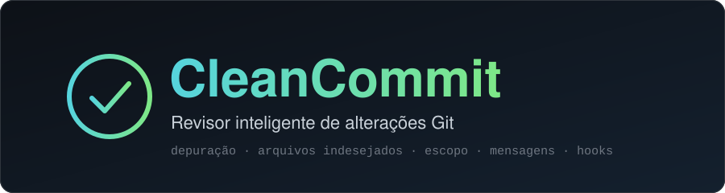
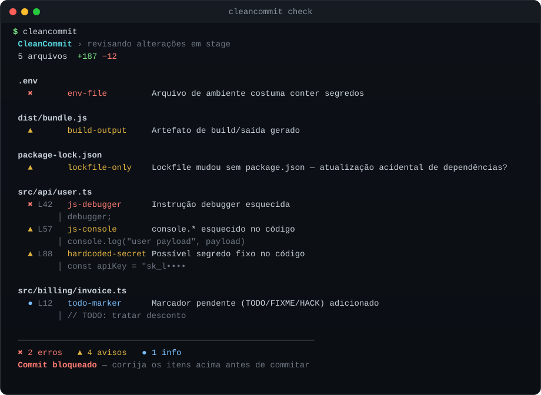
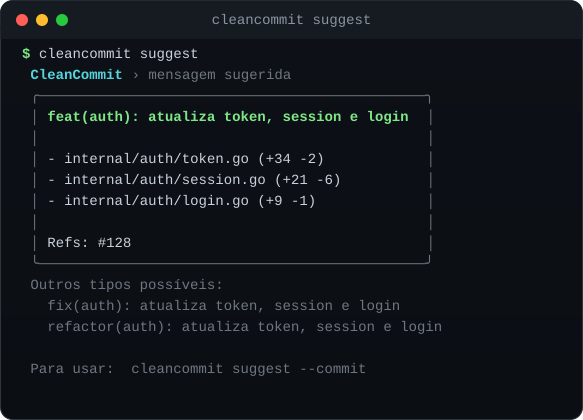
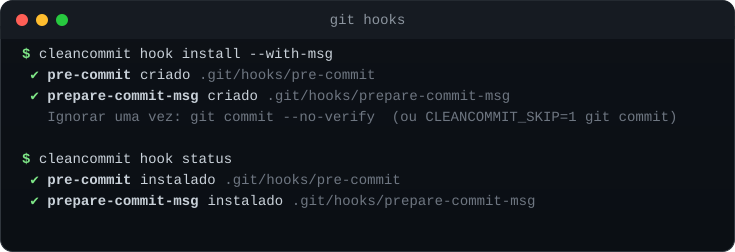

<p align="center">
  
</p>

<p align="center">
  
  
  
  
</p>

<p align="center"><b>Revise suas alterações antes que elas virem commit.</b><br>
Uma CLI rápida, em Go, que pega <code>console.log</code> esquecido, <code>.env</code> no stage, commits gigantes e ainda sugere a mensagem.</p>

<p align="center">
  
</p>

---

## Por que usar?

Todo mundo já fez um `git commit -am "wip"` com um `debugger;` perdido, um `.env` junto ou 40 arquivos misturados. O CleanCommit olha **exatamente o que está no stage**, aponta o que parece errado e deixa você corrigir *antes* de o commit existir.

- **Local e instantâneo**: nada de rede, nada de conta.
- **Zero dependências**: um único binário, só a biblioteca padrão do Go.
- **Fica fora do caminho**: só bloqueia o que você configurar. Dá para ignorar uma linha, uma regra ou o commit inteiro.

## Funcionalidades

| | Recurso | O que faz |
|---|---|---|
| 🐞 | **Código de depuração** | `console.log`, `debugger`, `breakpoint()`, `dbg!`, `System.out`, `var_dump`, `binding.pry`, testes `.only`, prints "debug/here" e mais |
| 🔐 | **Segredos e conflitos** | Chaves AWS, tokens GitHub/Slack, chaves privadas, `password = "..."` e marcadores `<<<<<<<` (o trecho é mascarado na saída) |
| 🗑️ | **Arquivos desnecessários** | `node_modules/`, `dist/`, `.env`, `*.log`, `.DS_Store`, `*.pyc`, `.idea/`, bancos locais, arquivos acima de um tamanho limite |
| ✍️ | **Mensagens de commit** | Sugere um [Conventional Commit](https://www.conventionalcommits.org/pt-br/) com tipo, escopo, assunto, corpo e `Refs:` da branch |
| 📏 | **Alterações excessivas** | Commits grandes, arquivo com churn enorme, mudanças só de espaço, lockfile sem manifesto, mistura de código + CI + deps + docs |
| 🪝 | **Git hooks** | `pre-commit` bloqueia; `prepare-commit-msg` já abre o editor com a mensagem sugerida |
| ⚙️ | **Regras personalizadas** | Regex por linha, arquivos proibidos, limites, ignorar caminhos e desativar regras em um `.cleancommit.json` |

## Instalação

Requer [Go 1.21+](https://go.dev/dl/) e Git.

```bash
make install        # instala em $(go env GOPATH)/bin
# ou, só compilando:
make build          # gera ./cleancommit
```

Confira:

```bash
cleancommit version
```

## Uso rápido

```bash
git add .
cleancommit               # revisa o stage (o mesmo que "cleancommit check")
```

<p align="center">
  
</p>

Cada achado mostra **severidade**, **linha**, **regra** e o **trecho** que disparou. O código de saída é `1` quando algo atinge o nível de bloqueio, o que serve tanto para hooks quanto para CI.

### Comandos

| Comando | Descrição |
|---|---|
| `cleancommit` / `cleancommit check` | Revisa o que está no stage |
| `cleancommit check --working` | Revisa o diretório de trabalho contra o `HEAD` |
| `cleancommit check --json` | Saída estruturada, com a mensagem sugerida incluída |
| `cleancommit check --fail-on warning` | Bloqueia também em avisos (`error`, `warning`, `info`, `never`) |
| `cleancommit suggest` | Sugere uma mensagem de commit |
| `cleancommit suggest --plain` | Só a mensagem, ideal para scripts |
| `cleancommit suggest --commit` | Faz o commit com a mensagem sugerida |
| `cleancommit hook install [--with-msg]` | Instala os hooks |
| `cleancommit hook uninstall` / `status` | Remove / consulta os hooks |
| `cleancommit init` | Cria um `.cleancommit.json` de exemplo |
| `cleancommit rules` | Lista todas as regras embutidas |

## Sugestão de mensagens

```bash
git add internal/auth
cleancommit suggest
```

<p align="center">
  
</p>

Como a sugestão é montada (tudo por heurística local, sem IA e sem rede):

1. **Tipo**: só docs → `docs`; só testes → `test`; só CI → `ci`; só manifestos → `build(deps)`; só espaços → `style`. Caso contrário, usa o prefixo da branch (`fix/…`, `feat/…`), arquivos novos de código (`feat`), palavras como *fix/bug/erro* nas linhas adicionadas (`fix`) ou remoções pesadas (`refactor`). Os outros tipos plausíveis aparecem como alternativas.
2. **Escopo**: o módulo comum a todos os arquivos (`internal/auth/…` → `auth`). Se os arquivos estão em módulos diferentes, fica sem escopo.
3. **Assunto**: verbo conforme o que aconteceu (adiciona, remove, renomeia, atualiza) + nomes dos arquivos, limitado a 72 caracteres.
4. **Corpo e rodapé**: lista dos arquivos com `+/-` e `Refs: #123` ou `Refs: PROJ-42`, extraídos do nome da branch.

Prefere inglês? Use `--lang en` ou `"language": "en"` na configuração.

## Integração com Git Hooks

```bash
cleancommit hook install --with-msg
```

<p align="center">
  
</p>

- **`pre-commit`**: roda `cleancommit check --hook` e interrompe o commit quando há achados bloqueantes.
- **`prepare-commit-msg`** (opcional, `--with-msg`): quando você roda `git commit` sem `-m`, o editor já abre com a mensagem sugerida. Mensagens passadas por `-m`, merges e squashes nunca são alteradas.

Detalhes que importam:

- Os hooks ficam dentro de um bloco delimitado. Rodar `install` de novo atualiza o bloco, e `uninstall` remove só ele.
- Se já existir um hook seu, o CleanCommit **não mexe** nele, a menos que você passe `--force` (aí ele anexa o bloco ao final).
- Respeita `core.hooksPath` e worktrees.
- Se o binário não estiver no `PATH`, o hook simplesmente não faz nada, em vez de travar seus commits.
- Para pular uma vez: `git commit --no-verify` ou `CLEANCOMMIT_SKIP=1 git commit`.

## Configuração e regras personalizadas

Crie o arquivo na raiz do repositório com `cleancommit init` (ou copie [`examples/.cleancommit.json`](examples/.cleancommit.json)). Todos os campos são opcionais.

```json
{
  "fail_on": "error",
  "language": "pt",
  "limits": {
    "max_files": 25,
    "max_lines": 600,
    "max_file_lines": 300,
    "max_file_size_kb": 512
  },
  "ignore_paths": ["vendor/", "docs/legacy/**"],
  "allow_files": [".vscode/settings.json"],
  "disable": ["py-print", "todo-marker"],
  "forbidden_files": [
    { "pattern": "*.tfstate", "severity": "error", "message": "State do Terraform contém segredos" }
  ],
  "rules": [
    {
      "id": "no-fixme",
      "pattern": "FIXME",
      "severity": "error",
      "paths": ["src/**", "internal/**"],
      "message": "Resolva o FIXME antes de commitar"
    }
  ]
}
```

| Campo | Descrição |
|---|---|
| `fail_on` | Nível que bloqueia o commit: `error` (padrão), `warning`, `info` ou `never` |
| `language` | Idioma das mensagens sugeridas: `pt` ou `en` |
| `limits` | Limites da análise de escopo. `0` desativa o limite |
| `ignore_paths` | Caminhos que o CleanCommit ignora por completo |
| `allow_files` | Exceções às regras de "arquivo indesejado" |
| `disable` | IDs de regras a desativar (veja `cleancommit rules`) |
| `forbidden_files` | Padrões de arquivo que nunca deveriam ser commitados |
| `rules` | Regras próprias: `id`, `pattern` (regex, sintaxe [RE2](https://github.com/google/re2/wiki/Syntax)), `severity`, `paths` (globs) e `message` |

Os globs seguem a lógica do `.gitignore`: `*.log` vale em qualquer pasta, `dist/` casa uma pasta inteira e `src/**/*.go` atravessa subpastas. Erros de digitação na configuração (campos desconhecidos, regex inválida) são reportados na hora, em vez de ignorados.

### Ignorando casos pontuais

Direto na linha, com um comentário:

```js
console.log(config); // cleancommit:ignore
console.log(config); // cleancommit:ignore=js-console
```

## Regras embutidas

Rode `cleancommit rules` para a lista completa e atualizada. Resumo:

| Categoria | Exemplos de regras |
|---|---|
| Segredos | `aws-access-key`, `private-key`, `github-token`, `slack-token`, `hardcoded-secret` |
| Conflitos | `conflict-marker` |
| Depuração | `js-console`, `js-debugger`, `js-focused-test`, `py-breakpoint`, `rust-dbg`, `java-sysout`, `php-dump`, `ruby-debugger`, `debug-print` |
| Arquivos | `env-file`, `private-key-file`, `dependency-dir`, `build-output`, `compiled-file`, `os-junk`, `log-file`, `local-database`, `large-file` |
| Escopo | `big-commit-files`, `big-commit-lines`, `huge-file-change`, `mixed-concerns`, `scattered-changes`, `lockfile-only`, `whitespace-only`, `mass-deletion` |

As regras de código analisam **somente as linhas adicionadas**. O que já existia no arquivo não gera ruído.

## Uso em CI

```bash
cleancommit check --working --fail-on warning --no-color
```

Com `--json`, a saída traz `blocked`, `summary` e a lista de `findings`, pronta para ser lida por outras ferramentas.

## Códigos de saída

| Código | Significado |
|---|---|
| `0` | Tudo certo (ou nada para revisar) |
| `1` | Há achados que atingem o nível de bloqueio |
| `2` | Erro de uso, configuração inválida ou fora de um repositório Git |

## Estrutura do projeto

```
main.go                  CLI e subcomandos
internal/git/            chamadas ao git e parser de diff
internal/analyzer/       regras de depuração, segredos, arquivos e escopo
internal/classify/       classificação de arquivos (código, testes, docs, CI...)
internal/suggest/        sugestão de mensagens (Conventional Commits)
internal/hooks/          instalação/remoção dos hooks
internal/config/         .cleancommit.json
internal/report/         saída colorida no terminal
```

## Desenvolvimento

```bash
make test     # go test ./...
make vet      # go vet ./...
make fmt      # gofmt -w .
```

## Roadmap

- [ ] Análise de um intervalo de commits (`--range origin/main..HEAD`)
- [ ] Auto-correção segura (`--fix` para remover `console.log` simples)
- [ ] Configuração em YAML/TOML
- [ ] Modo interativo no hook (perguntar antes de bloquear)

## Contribuindo

Issues e PRs são bem-vindos. Antes de abrir um PR, rode `make fmt vet test`. Para uma regra nova, adicione-a em `internal/analyzer/rules.go` e um teste em `analyzer_test.go`.

## Licença

[MIT](LICENSE)
